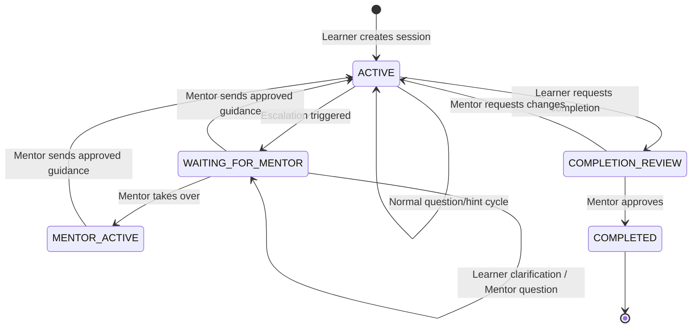
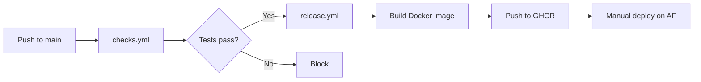

# RampUp — Automation Architecture & Service Integration Guide

## Executive Summary

RampUp is an AI-coached onboarding platform that guides junior engineers through an unfamiliar codebase using progressive, cited hints. **We did NOT use n8n, Zapier, or any external workflow automation tool.** Instead, we built a custom, self-contained automation pipeline directly in our Python/FastAPI backend.

---

## 1. How AI Automation Works (No n8n — Custom Built)

### 1.1 Architecture Overview

```
┌─────────────┐     ┌────────────────────────────────────────────┐
│   Frontend   │────▶│              FastAPI Backend                │
│  (React/TS)  │◀────│                                            │
└─────────────┘     │  ┌──────────┐  ┌─────────────────────────┐ │
                    │  │  Routes   │──│   Workflow Engine        │ │
                    │  │ (routes.py)│  │   (workflow.py)         │ │
                    │  └──────────┘  │   • State machine        │ │
                    │                │   • Idempotency           │ │
                    │                │   • Version locking       │ │
                    │                └───────────┬───────────────┘ │
                    │                            │                 │
                    │                ┌───────────▼───────────────┐ │
                    │                │   Coach Engine            │ │
                    │                │   (coach.py)              │ │
                    │                │   • Tool orchestration    │ │
                    │                │   • Citation validation   │ │
                    │                │   • Escalation rules      │ │
                    │                └───────────┬───────────────┘ │
                    │                            │                 │
                    │  ┌─────────────────────────▼──────────────┐  │
                    │  │  Model Adapter Layer                   │  │
                    │  │  ┌──────────────────┐ ┌──────────────┐│  │
                    │  │  │ GeminiGenerate   │ │ OpenAIResponses││ │
                    │  │  │ Content          │ │ (fallback)   ││  │
                    │  │  │(gemini_adapter.py)│ │(model_adapter)││ │
                    │  │  └──────────────────┘ └──────────────┘│  │
                    │  └───────────────────────────────────────┘  │
                    │                                            │
                    │  ┌────────────────────────────────────────┐ │
                    │  │  Repository Provider                   │ │
                    │  │  (repository.py)                       │ │
                    │  │  • GitHub REST adapter                 │ │
                    │  │  • Allowlisted read-only access        │ │
                    │  │  • PostgreSQL full-text search          │ │
                    │  └────────────────────────────────────────┘ │
                    └────────────────────────────────────────────┘
                                       │
                    ┌──────────────────▼───────────────────────┐
                    │         External Services                 │
                    │  ┌─────────┐  ┌──────────┐  ┌─────────┐ │
                    │  │  Neon   │  │ Gemini   │  │ GitHub  │ │
                    │  │ Postgres│  │ API      │  │ REST    │ │
                    │  └─────────┘  └──────────┘  └─────────┘ │
                    └──────────────────────────────────────────┘
```

### 1.2 The Custom AI Orchestration Pipeline

Instead of using n8n or a separate orchestration service, we built **three custom layers** directly in the backend:

#### Layer 1: `coach.py` — The Orchestration Engine
This is the heart of the automation. When a learner sends a message or submits an attempt:

1. **Input is saved first** (durable, idempotent) — if the AI call fails, the learner's work is never lost
2. **Deterministic rules execute before AI** — protected paths, manual escalation don't need AI
3. **Evidence retrieval** via `SnapshotTools` — searches PostgreSQL full-text index of pinned source code
4. **AI model call** with bounded tool loop (max 4 tool calls, max 6 model turns)
5. **Citation validation** — every AI claim must cite actual source text that was retrieved
6. **Support review** — a second AI call verifies the first AI's output against evidence and policy
7. **Escalation rules** — decides if human review is needed based on 5 deterministic triggers
8. **Transactional commit** — reacquires row locks, checks version hasn't changed during AI call

#### Layer 2: `model_adapter.py` + `gemini_adapter.py` — Pluggable Model Adapters
We built two model adapters behind a common `ModelAdapter` protocol:

| Adapter | Class | API | Status |
|---|---|---|---|
| **Gemini** | `GeminiGenerateContent` | `generativelanguage.googleapis.com/v1beta` | ✅ Active (production) |
| **OpenAI** | `OpenAIResponses` | `api.openai.com/v1/responses` | Available (fallback) |

The `model_factory.py` auto-selects based on the model name:
- Model name starts with `gemini-` → uses `GeminiGenerateContent`
- Otherwise → uses `OpenAIResponses`

Both adapters implement:
- **`generate(context, toolbox)`** — Main coaching call with structured JSON output and function calling
- **`review(context, result)`** — Independent verification of coaching quality

#### Layer 3: `SnapshotTools` — Custom AI Tool System
We built our own function-calling tool system. The AI model can call these **read-only** tools:

| Tool | Description | Budget |
|---|---|---|
| `search_project_context(query)` | Full-text search over pinned source excerpts | Max 12KB results |
| `read_project_file(path, start_line, end_line)` | Read bounded excerpt from pinned snapshot | Max 80 lines, 8KB |
| `get_learning_history()` | Read recent messages and attempts | Last 8 messages, 3 attempts |

**Security constraints:**
- Max 4 tool calls per turn
- Max 6 model loop iterations
- All paths validated against project allowlist
- No write tools, no shell, no URL fetcher
- Source IDs verified against actually-retrieved content

### 1.3 What We Built vs. What n8n Would Have Done

| Concern | Our Custom Approach | What n8n would do |
|---|---|---|
| AI orchestration | `coach.py` — in-process, synchronous, transactional | External workflow node |
| Tool calls | `SnapshotTools` — bounded, validated, in-process | MCP/webhook integration |
| Retries | Idempotency keys + agent_runs table | Retry node |
| Error handling | Per-category error tracking in DB | Error trigger node |
| State machine | `workflow.py` — row-locked state transitions | State node |
| Escalation triggers | 5 deterministic rules in `coach.py` | Conditional branch node |

**Why we chose custom over n8n:**
- **Transactional safety** — AI output commit must be atomic with state changes
- **Low latency** — no network hop to external orchestrator
- **Citation validation** — needs in-process access to retrieved evidence
- **Version locking** — prevents late AI results from overwriting mentor decisions
- **Simplicity** — one Python process, one database, no additional infrastructure

---

## 2. Service Integration Map

### 2.1 Services We Integrate With

| Service | Purpose | How We Connect | Module |
|---|---|---|---|
| **Neon PostgreSQL** | Primary database (all state) | `psycopg` driver via SQLAlchemy | `db.py` |
| **Google Gemini API** | AI coaching model | HTTPS REST via `httpx` | `gemini_adapter.py` |
| **GitHub REST API** | Read source code from repos | HTTPS REST via `httpx` | `repository.py` |
| **Alternate Futures** | Cloud hosting platform | Docker container deployment | `Dockerfile` |
| **GitHub Container Registry** | Docker image storage | GitHub Actions → GHCR | `release.yml` |

### 2.2 How Each Service Connection Works

#### Neon PostgreSQL
- **Connection**: SQLAlchemy `create_engine()` with `postgresql+psycopg://` driver
- **Pooling**: Pool size 3, max overflow 2, recycle every 240s, pre-ping enabled
- **TLS**: `sslmode=require&channel_binding=require` (Neon requirement)
- **Migrations**: Alembic with version tracking in `alembic_version` table
- **Used for**: Users, sessions, messages, attempts, escalations, source chunks, events, idempotency requests

#### Google Gemini API
- **Endpoint**: `https://generativelanguage.googleapis.com/v1beta/models/{model}:generateContent`
- **Auth**: API key via `x-goog-api-key` header
- **Model**: `gemini-3.1-flash-lite` (configurable via `LLM_MODEL` env var)
- **Features used**:
  - Structured JSON output (`responseMimeType: application/json`, `responseJsonSchema`)
  - Function calling (`functionDeclarations` in tools)
  - System instructions
- **Timeout**: 20s per request, 32s total generation deadline
- **Used for**: Generating coaching hints, assessing attempts, reviewing evidence support

#### GitHub REST API
- **Endpoint**: `https://api.github.com/repos/{owner}/{repo}/...`
- **Auth**: Optional Bearer token (for rate limit relief)
- **Used for**:
  - `commits/{ref}` — resolve branch to pinned SHA
  - `contents/{path}?ref={sha}` — read allowlisted source files
  - `issues/{number}` — read issue details (optional)
- **Security**: Owner/repo restricted to configured allowlist; paths must be in project's `allowed_paths`

---

## 3. The Workflow State Machine

### 3.1 Session States



### 3.2 Escalation Triggers (5 Rules)

| # | Trigger | Rule | Implementation |
|---|---|---|---|
| 1 | **Manual** | Learner clicks "Request Mentor" | `POST /sessions/{id}/escalations` with `reason: "MANUAL"` |
| 2 | **Protected Path** | Attempt file path matches `task.policy.protected_paths` | `protected()` function in `repository.py` |
| 3 | **Repeated Difficulty** | `attempt_threshold` (default: 3) consecutive UNRESOLVED attempts on same milestone | Counted in `coach.py` lines 454-472 |
| 4 | **Missing Evidence** | No supporting source found; asks 1 clarification, then escalates | `missing_evidence_count` on session, lines 482-494 |
| 5 | **Source Conflict** | Contradictory docs detected (configured pair) | `configured_conflict` in task policy, lines 348-351 |

---

## 4. Hosting Architecture

### 4.1 The Hosting Stack

```
┌─────────────────────────────────────────────────────────┐
│                ALTERNATE FUTURES                         │
│         (Web Hosting / Container Platform)               │
│                                                         │
│  ┌───────────────────────────────────────────────────┐  │
│  │  Docker Container (single image)                  │  │
│  │                                                   │  │
│  │  ┌─────────────────────────────────────────────┐  │  │
│  │  │  FastAPI (Uvicorn, 1 worker)                │  │  │
│  │  │  • /api/v1/*     → API routes               │  │  │
│  │  │  • /healthz      → Health check             │  │  │
│  │  │  • /readyz       → DB readiness             │  │  │
│  │  │  • /assets/*     → Static files (CSS/JS)    │  │  │
│  │  │  • /*            → SPA fallback (index.html)│  │  │
│  │  └─────────────────────────────────────────────┘  │  │
│  └───────────────────────────────────────────────────┘  │
│                          │                               │
│                    HTTPS (port 8000)                     │
└─────────────────────────────────────────────────────────┘
         │                    │                   │
         ▼                    ▼                   ▼
┌──────────────┐    ┌──────────────┐    ┌──────────────┐
│  Neon        │    │  Gemini API  │    │  GitHub API  │
│  PostgreSQL  │    │  (Google)    │    │  (Microsoft) │
│              │    │              │    │              │
│  DB Host     │    │  AI Model    │    │  Source Code  │
│  (ap-south-  │    │  Service     │    │  Reads       │
│  east-1)     │    │              │    │              │
└──────────────┘    └──────────────┘    └──────────────┘
```

### 4.2 Role of Each Hosting Service

| Service | Role | What It Hosts | Why |
|---|---|---|---|
| **Alternate Futures** | **Web hosting / container runtime** | The Docker container with FastAPI + compiled React assets | Chosen as the hackathon's deployment platform |
| **Neon** | **Database host (DBaaS)** | PostgreSQL 18.6, all application state | Serverless Postgres; auto-scales, no ops needed |
| **GitHub (GHCR)** | **Container registry** | Docker images (`ghcr.io/muhammad-moiz-ansari/rampup:sha-...`) | Free with GitHub, CI/CD integrated |
| **Gemini API** | **AI model service** | Runs inference for coaching responses | Fast, structured output, function calling |
| **GitHub REST** | **Source code API** | Provides repo file contents for indexing | Read-only, allowlisted paths |

### 4.3 Is Alternate Futures Our Web Host?

**Yes.** Alternate Futures (`clouds.alternatefutures.ai`) is our **web hosting platform**. It runs our Docker container and exposes it via HTTPS. Our deployed URL is:
```
https://alternate-cloudy-serpent-6983-docker-app.alternatefutures.ai
```

### 4.4 Is Neon Our Backend Host?

**No.** Neon is our **database service only** (Database-as-a-Service). Our backend application code runs inside the Docker container on Alternate Futures. Neon just hosts the PostgreSQL database that the backend connects to over the network.

### 4.5 What About Our DB Service?

Our DB service is **Neon** — a serverless PostgreSQL provider:
- **Region**: `ap-southeast-1` (AWS Singapore)
- **Version**: PostgreSQL 18.6
- **Connection**: Two endpoints:
  - **Pooled** (`-pooler` endpoint): Used by the app at runtime
  - **Direct**: Used by Alembic for migrations
- **Features used**: Full-text search (`TSVECTOR`/`GIN` indexes), partial unique indexes, JSONB columns
- **Tables**: 13 tables (users, projects, tasks, sessions, messages, attempts, source_chunks, escalations, mentor_decisions, agent_runs, events, idempotency_requests, alembic_version)

---

## 5. CI/CD Pipeline



| Step | Workflow | What Happens |
|---|---|---|
| PR/Push checks | `checks.yml` | Lint (ruff), pytest against Postgres service, frontend typecheck + build, Docker build |
| Image release | `release.yml` | Builds Docker image, pushes to `ghcr.io/muhammad-moiz-ansari/rampup:sha-{commit}` |
| Deployment | Manual | Select image tag on Alternate Futures dashboard, configure env vars |

---

## 6. Data Flow: What Happens When a Learner Sends a Message

```
1. Frontend POST /api/v1/sessions/{id}/messages
   Headers: Authorization: Bearer <token>, Idempotency-Key: <uuid>
   Body: { "content": "How do I validate quantities?" }

2. routes.py → auth → session_access → coach.submit_input()

3. coach.py:
   a. Lock session row (SELECT FOR UPDATE)
   b. Check idempotency (reuse or create operation)
   c. Check session state (must be ACTIVE for AI)
   d. Save learner message (durable before AI call)
   e. Build context (task, policy, milestone, history, approved guidance)
   f. Release DB lock (commit)
   
   g. SnapshotTools.search(query) → PostgreSQL full-text search
   h. Check configured conflict pairs
   
   i. GeminiGenerateContent.generate(context, toolbox)
      → Model may call search_project_context(), read_project_file()
      → Max 4 tool calls, max 6 loop iterations
      → Returns structured CoachResult JSON
   
   j. validate_citations(result, toolbox)
      → Every citation must point to actually-retrieved source
      → Quoted text must exist in the cited excerpt
   
   k. GeminiGenerateContent.review(context, result)
      → Second AI call: is the hint supported by evidence?
      → Is it policy-compatible (no full solutions under HINTS)?
   
   l. Reacquire session lock
   m. Check version unchanged (no mentor intervention during AI call)
   n. Save AI message with validated citations
   o. Update agent_run status
   p. Commit transaction
   
4. Return updated SessionDetail to frontend
```

---

## 7. Security Model

| Layer | Protection |
|---|---|
| **Auth** | JWT tokens (HS256), 120-min TTL, audience claim |
| **Authorization** | Role-based (LEARNER/MENTOR) + assignment-based (task ownership) |
| **Idempotency** | Per-user, per-route, body-hash verified |
| **AI Safety** | Read-only tools, bounded calls, citation validation, policy review |
| **Repository** | Allowlisted paths, traversal prevention, secret scanning, binary exclusion |
| **Concurrency** | Row-level locks, version checks, one active run per session |
| **State Machine** | Explicit transitions, no AI can close escalations or approve completions |
