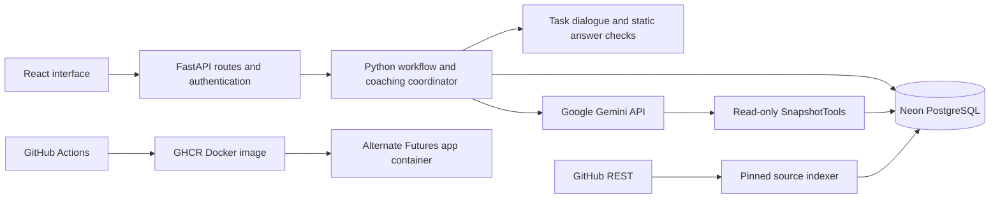

# Automation and Integrations

## Orchestration

RampUp does not use n8n or a separate workflow engine. The application owns a small, explicit orchestration flow in FastAPI and Python: routes authenticate and authorize each request, `coach.py` coordinates a bounded coaching turn, and `workflow.py` performs the transactional session and mentor-state changes. PostgreSQL persists inputs and runs before network calls; the app releases database locks while calling external services, then rechecks the session version and state before saving a result. Alembic manages schema changes.

This is application-specific orchestration, not a general-purpose automation builder. A learner request can trigger retrieval, a model response, validation, and possibly a mentor handoff. A mentor decision is an authenticated API action that is checked against the current case revision. Idempotency keys, run expiry, row locks, and database uniqueness constraints protect retries and concurrent decisions.

## Learning-session lifecycle

The current task catalog contains two focused experiences. Their dialogue, exercise prompt, starting code and answer rules are defined in `backend/app/walkthroughs.py`; `scripts.export_walkthrough` generates the Markdown operator guide in `docs/demo-script.md`. Question and answer handling enters the same authenticated, persisted workflow as other requests. These two task experiences use server-owned response sequences and static Python AST comparisons, so they do not require a Gemini request for each prescribed turn. AST parsing ignores formatting and comments and does **not** execute submitted code. The general model-backed coaching path remains available for other tasks.

Task 1 accepts the corrected optional-description field declaration. Task 2 presents a focused update function: the first submission opens a source-conflict case with both pinned sources and the learner's attempt. Coaching pauses while the mentor and learner converse. An assigned mentor's **Send guidance** resolves the case; the learner can then submit the corrected function. Mentor conversation text is authored freely and delivered exactly.

There is no fixed session duration or question quota. A learner session remains `ACTIVE` until the learner requests completion. That request moves it to `COMPLETION_REVIEW`; only the assigned mentor can approve it and move it to `COMPLETED`. A mentor can instead reject completion and return it to `ACTIVE`. Completed sessions are read-only. The session can also pause in `WAITING_FOR_MENTOR` or `MENTOR_ACTIVE` while an escalation is being resolved.

The general model-backed policy sets `attempt_threshold` to **3**. It counts explicit submissions assessed as `UNRESOLVED` on the current milestone, looking back to the latest assessed `PROGRESS`; chat messages do not count. `PROGRESS` resets the count and advances to the next milestone when one exists. Assessment does not mean tests ran: learner code and test output are never executed. The current Task 2 mentor-review gate is independent of this general counter. The two questions in each operator guide are the prescribed interaction sequence, not a question quota or a session termination rule.

Other handoff paths are independent of that threshold:

- The learner can request a mentor at any time.
- An explicit submitted or AI-proposed path matching a protected-path rule triggers mentor review.
- When evidence is missing or fails support/policy checks, the coach asks for one clarification; a second unsupported turn escalates.
- Source conflicts require human review. The current quantity task includes the README/schema conflict as part of its task policy, with both repository excerpts attached to the case.

The time limits apply to a single AI turn, not the learning session: generation has a 32-second deadline, semantic review has a 10-second deadline, and persisted in-flight runs expire after 50 seconds. The model may make at most four app-provided read-tool calls per turn.

## Services

| Service | Use |
| --- | --- |
| PostgreSQL | Users, tasks, sessions, messages, attempts, mentor cases/decisions, run and idempotency records, and pinned source chunks. Built-in full-text search retrieves source chunks. |
| Neon | The hosted PostgreSQL database used by both local acceptance testing and the configured deployment. Its database compute runs Postgres; it does not run this application's FastAPI server or serve the React interface. |
| GitHub REST API | `scripts.index_sources` resolves a commit and reads configured allowlisted files. It stores bounded excerpts in PostgreSQL. Coaching turns search this pinned snapshot; they do not let the model browse GitHub directly. |
| OpenAI Responses API | Optional model provider for structured coaching and a separate support/policy review. |
| Google Gemini GenerateContent API | The configured model-backed coaching provider, selected by `LLM_PROVIDER=gemini` or a `gemini-` model name. Native requests go directly to Google with the key in a header. Only one provider is used for a runtime configuration; there is no automatic fallback that sends the Gemini key to OpenAI. |
| GitHub Actions and GHCR | CI runs checks and publishes immutable Docker images. This is build/release automation, not session orchestration. |
| Alternate Futures | The application's hosting/control platform. It provisions a container with FastAPI and the compiled React assets and supplies a public HTTPS route. Standard compute uses the selected underlying provider; Neon remains a separate database service. Cloud deployment work is currently left to the owner as requested. |
| Docker | The application image packages FastAPI and built frontend assets. Docker Compose can additionally run a local PostgreSQL service. The cloud application's database connection points to Neon, not a database inside the app container. |

The model requests a tool by name and JSON arguments. The Python application validates and executes that bounded read, then returns the result to the model. Gemini does not receive database credentials, a GitHub token, a shell or arbitrary network access. Source files and learner input are treated as untrusted content. For model-backed hints, the application validates citation IDs/ranges/quotes and performs a separate support/policy review before delivery. Human approvals remain authenticated application actions, never model tool calls.

## Model tools and service boundary

The app defines three narrow, read-only function tools in `model_adapter.py` and exposes their implementations through `SnapshotTools` in `coach.py`:

- `search_project_context(query)` searches only the task's pinned, indexed repository excerpts.
- `read_project_file(path, start_line, end_line)` reads a bounded excerpt only from allowlisted, indexed paths and lines.
- `get_learning_history()` returns a bounded slice of this session's messages and attempts.

The model can request one of these functions, but it cannot execute it or call a service on its own. The backend validates each call, executes the app-owned function, bounds its response, and sends the result back to the model. Session and project identity come from authenticated server state, not model-supplied arguments. The GitHub token and model API key stay server-side. There is no shell, arbitrary URL fetch, SQL, repository write, code execution, or general external-service tool.

The model returns schema-constrained JSON. The backend validates the result, checks citation source IDs, ranges, and exact quoted text, and separately asks the selected model to review factual support and policy compatibility. That semantic review is fallible; state transitions, protected paths, thresholds, authorization, and final mentor approval remain server-controlled.

## Code map

- [`backend/app/routes.py`](../backend/app/routes.py): authentication, role checks, API endpoints, completion and mentor decisions.
- [`backend/app/coach.py`](../backend/app/coach.py): input persistence, context retrieval, model/tool loop, evidence checks, and escalation.
- [`backend/app/workflow.py`](../backend/app/workflow.py): session state, access rules, escalation records, idempotency, and transaction helpers.
- [`backend/app/model_adapter.py`](../backend/app/model_adapter.py) and [`backend/app/gemini_adapter.py`](../backend/app/gemini_adapter.py): provider adapters, tool declarations, structured output, and bounded requests.
- [`backend/app/repository.py`](../backend/app/repository.py) and [`backend/scripts/index_sources.py`](../backend/scripts/index_sources.py): allowlisted GitHub reads and commit-pinned indexing.
- [`backend/scripts/seed_demo.py`](../backend/scripts/seed_demo.py): actor setup and the two current tasks; old task histories are retained.
- [`backend/app/walkthroughs.py`](../backend/app/walkthroughs.py): task dialogue, exercise metadata and static answer checks.
- [`docs/demo-script.md`](demo-script.md): exact learner questions, responses, submission code and mentor handoff steps.

The React interface now supports learner and mentor sign-in, task workspaces, specific answer exercises, citations, mentor review/conversation and completion approval. The local combined app runs at `http://localhost:8002`, using the deployment's Neon database through the ignored root `.env`. Actor access is in the Git-ignored `.local/actor-credentials.md`. Tokens expire after the configured 120 minutes; signing in again restores the saved session.

Neon describes its compute as a Postgres process in its [compute documentation](https://neon.com/docs/manage/endpoints/). Google documents the configured model in the [Gemini 3.1 Flash-Lite reference](https://ai.google.dev/gemini-api/docs/models/gemini-3.1-flash-lite). A small live check accepted the configured key/model and returned structured JSON over HTTP 200. That verifies connectivity/authentication, not a broad benchmark of reasoning quality.
